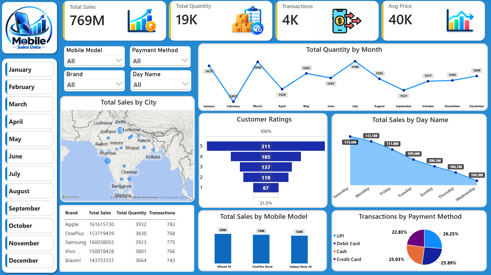

# 📱 Mobile Sales Data Analysis Dashboard

An interactive Power BI dashboard designed to analyze mobile sales performance, customer purchasing behavior, brand performance, and payment trends. The dashboard transforms raw transaction data into meaningful business insights using KPIs, interactive filters, and data visualizations.

---

## 1. Project

### 📱 Mobile Sales Data Analysis Dashboard

A dynamic and interactive Power BI dashboard developed to analyze mobile sales performance across different mobile brands, mobile models, payment methods, cities, customer ratings, and time periods.

The dashboard provides a consolidated view of key business metrics and enables users to identify sales trends, top-performing brands, popular mobile models, and customer purchasing patterns.

---

## 2. Description

The **Mobile Sales Data Analysis Dashboard** is a Power BI analytics project developed to evaluate overall sales performance, customer purchasing behavior, and brand-level performance.

The dashboard enables users to analyze key business KPIs such as **Total Sales, Total Quantity Sold, Total Transactions, and Average Price**, while providing detailed analysis across different business dimensions.

The goal is to transform raw mobile sales transaction data into meaningful business insights that can support **data-driven decision-making, sales optimization, and business performance evaluation**.

---

## 3. Tech Stack

The dashboard was built using the following tools and technologies:

- 📊 **Microsoft Power BI Desktop** – Main platform used for dashboard development and data visualization.
- 📂 **Power Query** – Used for data cleaning, transformation, and preparation.
- 🧠 **DAX (Data Analysis Expressions)** – Used to create calculated measures and KPI metrics.
- 🗂️ **Data Modeling** – Used to structure the data for efficient analysis and visualization.
- 📈 **Data Visualization** – KPI cards, map visualizations, bar charts, line charts, pie charts, tables, and interactive slicers.
- 📁 **File Format** – `.pbix` for the Power BI project and `.png` for the dashboard preview.

---

# 4. Business Requirement

The objective of this project is to conduct a comprehensive analysis of **mobile sales performance, customer purchasing behavior, and brand performance** to identify key insights and opportunities for business growth using KPIs and visualizations in Power BI.

### Key Performance Indicators

The dashboard focuses on four primary KPIs:

| KPI | Description |
|---|---|
| 💰 Total Sales | Overall revenue generated from mobile sales transactions |
| 📦 Total Quantity | Total number of mobile units sold |
| 🧾 Transactions | Total number of sales transactions recorded |
| 📊 Average Price | Average selling price per mobile unit |

---

# 5. Data Source

The project uses a Mobile Sales dataset containing information related to mobile transactions, brands, mobile models, customer details, geographical locations, payment methods, and customer ratings.

The dataset contains **3,835 transaction records** covering the period from **2021 to 2024**.

The dataset supports analysis across:

- Transaction ID
- Day, Month, and Year
- Day Name
- Brand
- Units Sold
- Price Per Unit
- Customer Name
- Customer Age
- City
- Payment Method
- Customer Ratings
- Mobile Model

Total Sales is calculated using Units Sold multiplied by Price Per Unit.

---

# 6. Features

## 🔹 Business Problem

Mobile businesses generate large amounts of sales data across different brands, mobile models, customer segments, locations, and payment methods. Analyzing this data manually can make it difficult to identify sales trends, high-performing brands, customer preferences, and purchasing patterns.

This dashboard addresses these challenges by providing an interactive view of mobile sales performance and allowing users to analyze business metrics across multiple dimensions.

### Key Business Questions

- Which mobile brands generate the highest total sales?
- Which mobile models contribute the most to overall revenue?
- Which cities generate the highest mobile sales?
- How does mobile sales quantity vary across different months?
- Which days of the week generate the highest sales?
- Which payment methods are most frequently used by customers?
- How are customer ratings distributed across different rating levels?
- How do sales and transaction volumes vary across different brands?
- Which mobile models are performing better in terms of revenue generation?

---

## 🎯 Goal of the Dashboard

The primary goal of the dashboard is to provide an interactive analytical tool that:

- Evaluates overall mobile sales performance.
- Tracks key business KPIs.
- Identifies high-performing mobile brands.
- Analyzes sales performance across different mobile models.
- Evaluates monthly sales quantity trends.
- Analyzes geographical sales distribution across cities.
- Compares sales performance across different days of the week.
- Analyzes customer ratings and satisfaction.
- Evaluates customer payment preferences.
- Supports data-driven business decisions.

---

# 7. Granular Analysis

## 📅 1. Total Quantity by Month

### Objective

Analyze monthly mobile sales quantity to identify seasonal trends and fluctuations in customer demand.

The dashboard compares total mobile units sold across all twelve months:

- January
- February
- March
- April
- May
- June
- July
- August
- September
- October
- November
- December

This analysis helps identify months with higher and lower sales volumes and understand monthly purchasing patterns.

---

## 📍 2. Total Sales by City

### Objective

Analyze the geographical distribution of mobile sales across different cities.

The dashboard uses a map visualization to display sales performance across cities such as:

- Delhi
- Mumbai
- Bangalore
- Hyderabad
- Ahmedabad
- Chennai
- Kolkata
- Surat
- Pune
- Ludhiana
- Lucknow
- Jodhpur
- Ranchi
- Bhopal
- Indore
- Rajkot
- Gorakhpur
- Kanpur
- Madurai

This analysis helps identify geographical markets contributing significantly to overall revenue.

---

## ⭐ 3. Customer Ratings

### Objective

Evaluate customer satisfaction by analyzing the distribution of ratings provided by customers.

The dashboard compares customer ratings across five levels:

- 5-Star Rating
- 4-Star Rating
- 3-Star Rating
- 2-Star Rating
- 1-Star Rating

This visualization helps understand customer feedback patterns and provides insights into overall customer satisfaction.

---

## 📈 4. Total Sales by Day Name

### Objective

Analyze mobile sales performance across different days of the week.

The dashboard compares total sales across:

- Saturday
- Monday
- Friday
- Tuesday
- Sunday
- Thursday
- Wednesday

This analysis helps identify which days generate higher sales revenue and understand weekly purchasing patterns.

---

## 📱 5. Total Sales by Mobile Model

### Objective

Identify the performance of different mobile models in terms of total sales revenue.

The dashboard compares mobile models such as:

- iPhone SE
- OnePlus Nord
- Galaxy Note 20
- Vivo Y51
- Galaxy S21
- iPhone 11
- Galaxy A51
- iPhone 12
- Mi 11
- Redmi Note 10
- OnePlus 8T
- OnePlus 9
- Vivo V20
- Vivo S1
- Redmi 9

This analysis helps identify the most revenue-generating mobile models and understand product-level sales performance.

---

## 💳 6. Transactions by Payment Method

### Objective

Analyze customer payment preferences by comparing the number of transactions across different payment methods.

The dashboard compares:

- UPI
- Debit Card
- Cash
- Credit Card

This analysis helps understand customer payment behavior and identify the most commonly used payment methods.

---

## 🏷️ 7. All Metrics by Brand

### Objective

Provide a comprehensive comparison of key mobile sales metrics across different brands.

The dashboard compares:

- Total Sales
- Total Quantity
- Transactions

Brands analyzed include:

- Apple
- OnePlus
- Samsung
- Vivo
- Xiaomi

This analysis helps evaluate brand-level performance and identify the strongest contributors to overall sales revenue.

---

# 8. Walkthrough of Key Visuals

## 📊 KPI Cards

The dashboard displays four primary KPIs:

- **Total Sales:** 769.20M
- **Total Quantity:** 19K
- **Transactions:** 4K
- **Average Price:** 40K

These provide an immediate overview of overall mobile sales performance.

---

## 📈 Monthly Quantity Trend

A line chart displays the total quantity of mobile units sold across all twelve months.

The visualization helps identify monthly fluctuations in sales volume and highlights periods of stronger and weaker customer demand.

The dashboard records the highest monthly sales quantity at approximately **1,700 units in July**, while February records the lowest at approximately **1,451 units**.

---

## 📍 City-Wise Sales Performance

The map visualization displays total sales distribution across different cities.

It helps identify geographical markets contributing significantly to overall revenue.

**Delhi** is the highest-performing city in the dataset, generating approximately **203.88M** in total sales, followed by Mumbai with approximately **127.19M**.

---

## ⭐ Customer Ratings

The horizontal bar chart represents the distribution of customer ratings from 1 to 5.

This visualization provides an overview of customer feedback and helps evaluate customer satisfaction across mobile purchases.

---

## 📅 Day-Wise Sales Performance

The area chart compares total sales across different days of the week.

**Saturday** records the highest sales at approximately **114.6M**, followed by Monday at approximately **113.5M**.

Wednesday records the lowest sales at approximately **104.9M**.

This analysis helps identify weekly sales patterns and customer purchasing behavior.

---

## 📱 Mobile Model Performance

The bar chart ranks mobile models according to their total sales revenue.

**iPhone SE** is the highest-performing mobile model, generating approximately **59.57M**, followed by OnePlus Nord at approximately **57.89M** and Galaxy Note 20 at approximately **56.01M**.

This visualization helps identify top-performing products and supports product-level sales analysis.

---

## 💳 Payment Method Distribution

The pie chart compares the percentage distribution of transactions across four payment methods:

- UPI
- Debit Card
- Cash
- Credit Card

This visualization helps understand customer payment preferences and the contribution of different payment methods to total transactions.

---

## 🏷️ Brand-Wise Sales Performance

The brand-level table provides a detailed comparison of:

- Total Sales
- Total Quantity
- Transactions

Apple generates the highest total sales at approximately **161.62M**, followed by Samsung at approximately **160.04M** and OnePlus at approximately **153.72M**.

This comparison helps evaluate brand performance across multiple business metrics.

---

# 9. Business Impact & Insights

### 📈 Sales Optimization

The dashboard provides a centralized view of mobile sales performance, helping identify high-performing and low-performing sales periods.

### 📱 Product Strategy

Mobile model-level analysis helps identify products contributing significantly to overall revenue and can support product prioritization and sales planning.

### 🏷️ Brand Performance

Comparing sales across different mobile brands helps evaluate brand-level revenue contribution and identify stronger-performing brands.

### 📍 Geographical Analysis

Analyzing sales across different cities helps identify important geographical markets and potential opportunities for business expansion.

### ⭐ Customer Satisfaction

Customer rating analysis provides insights into customer feedback and satisfaction levels, helping businesses understand customer experiences.

### 💳 Payment Preferences

Analyzing transactions across different payment methods helps businesses understand customer payment preferences and evaluate payment channel usage.

### 🎯 Data-Driven Decision Making

Interactive Power BI visualizations allow users to explore different business segments and make faster, evidence-based business decisions.

---

# 10. Interactive Filters

The dashboard includes interactive slicers that allow users to filter the analysis by:

- 📱 Mobile Model
- 💳 Payment Method
- 🏷️ Brand
- 📅 Day Name
- 📆 Month (January to December)

The visuals update dynamically based on the selected filters, allowing users to perform detailed analysis across different dimensions.

---

# 11. Dashboard Preview

---

# 12. Project Highlights

- ✅ Analyzed **769.20M** in total mobile sales.
- ✅ Evaluated **19,150 mobile units sold**.
- ✅ Analyzed **3,835 sales transactions**.
- ✅ Calculated **Average Price per Unit**.
- ✅ Analyzed sales performance across **5 mobile brands**.
- ✅ Evaluated sales across **15 mobile models**.
- ✅ Analyzed geographical sales distribution across **19 cities**.
- ✅ Evaluated monthly mobile sales quantity trends.
- ✅ Analyzed customer ratings and satisfaction.
- ✅ Compared sales performance across different days of the week.
- ✅ Evaluated customer payment preferences.
- ✅ Created interactive KPI cards and visualizations using Power BI.
- ✅ Built an interactive dashboard with dynamic slicers.
- ✅ Generated actionable business insights to support data-driven decision-making.

---
